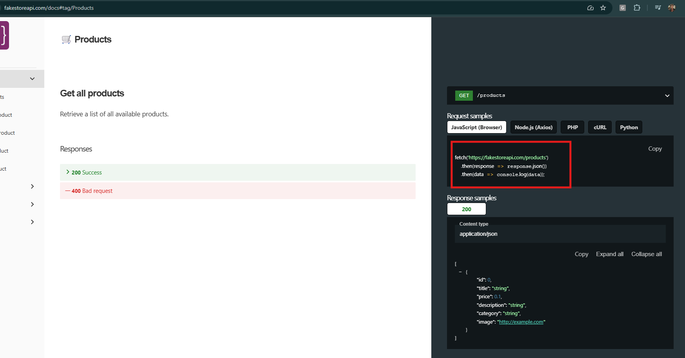
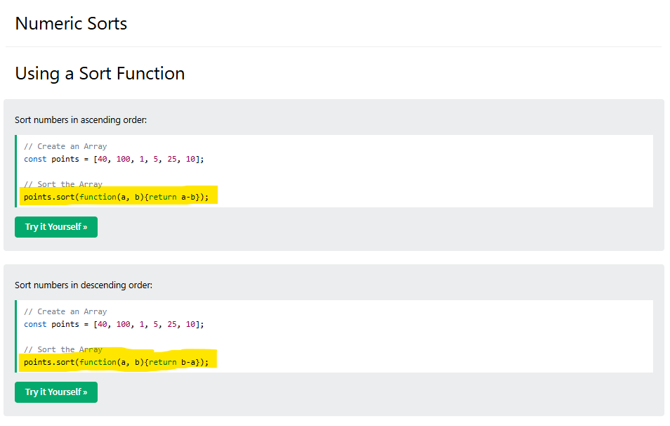
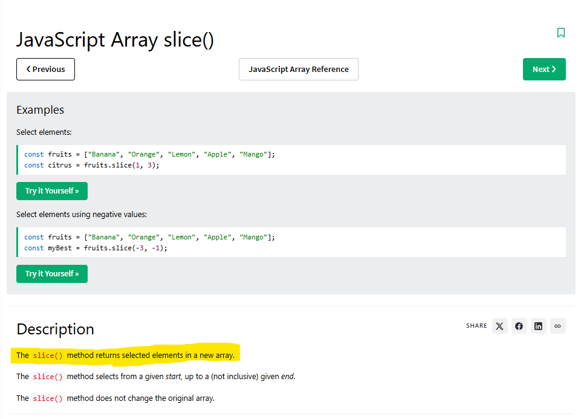
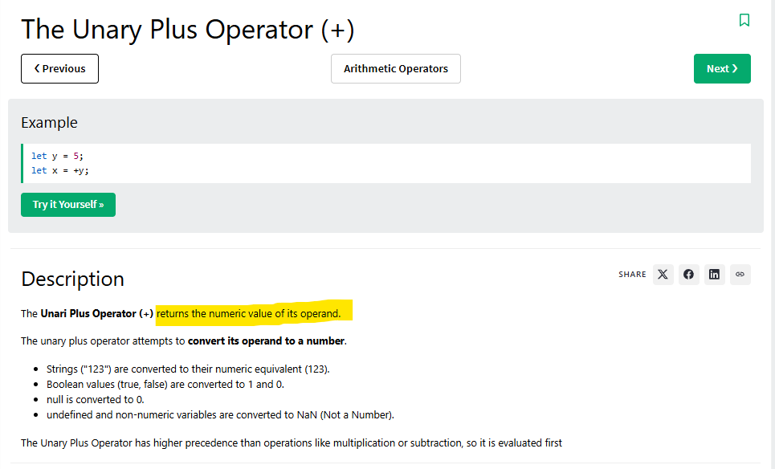
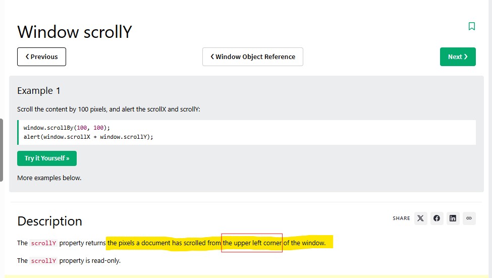
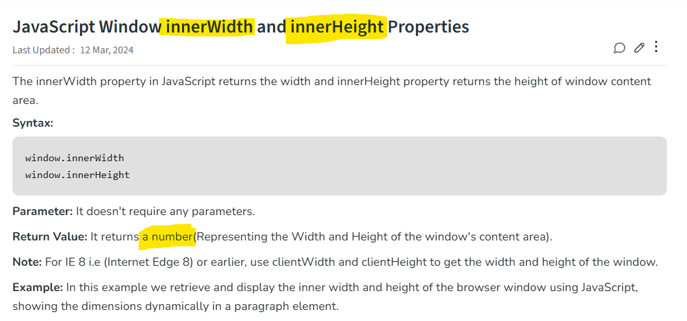
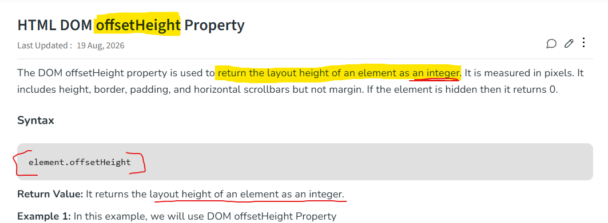
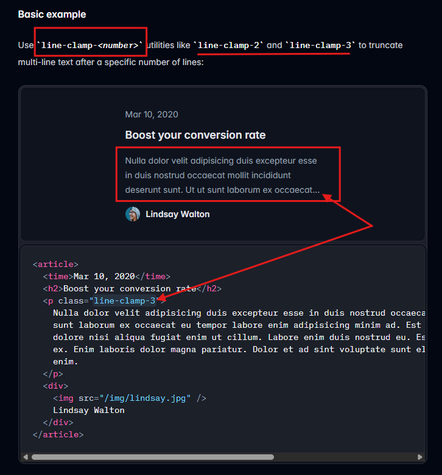

# SmartShop

CSE-3532 Mid Project. HTML, Tailwind CSS and JavaScript.

**Run:** open `index.html` with Live Server.

| Name | ID | Work |
|---|---|---|
| Tafsirul Islam | C243025 | JS  |
| Rafi Alam | C243015 | HTML/CSS |
| Hasan Al Faozan | C243048 | HTML/CSS |

## References

**Products API** (`fetch`)

**Sorting** (`sort`)

**Copy array** (`slice`)

**Balance from localStorage** (`+`)

**Active menu link** (`scrollY`, `innerHeight`, `offsetHeight`)

**Short titles** (`line-clamp`)

Icons: [Heroicons](https://heroicons.com) (MIT)
